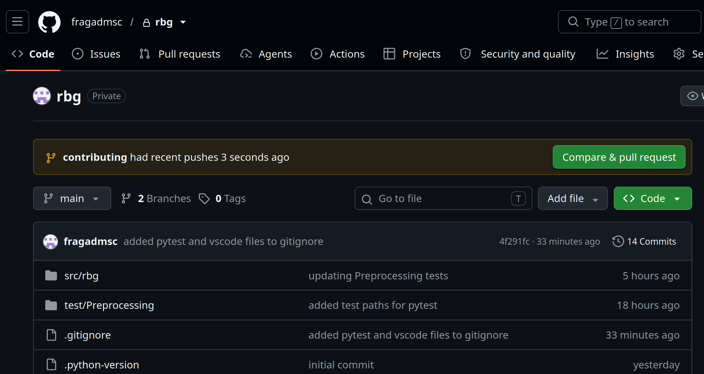
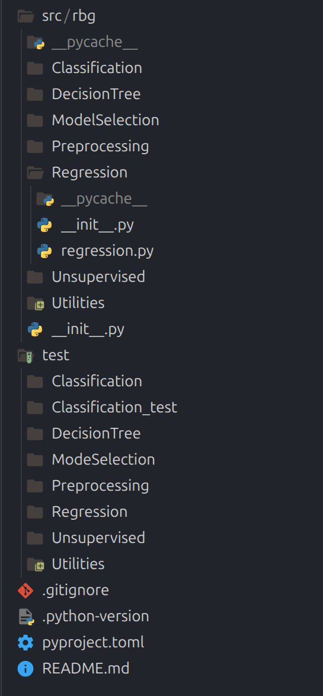

## RBG (Regressão Bem Geral)
##### *a.k.a Rodrigo do Bigode Grosso*

This is the official repository for the machine learning library titled RBG.

This file contains the structure of the library, the workflow with git/github that should be used and the code style guides. This document should be referred to if you have some doubt (it is also a good context base for asking something to AI).

#### Quickstart

Clone the repository locally with `git clone` (it may be useful to ask some AI on how to do this basic setup, but it should be very quick), and then run `uv sync` to install the necessary dependencies.

#### Git/Github workflow

##### Good practices

Each feature should be developed in a separate branch, and no two people should work in the same branch or feature at the same time. The branches are meant to be incremental: don't create only one branch for all of your work. Instead, create a branch for every feature you want to implement, make a pull request to merge it into the main, and then delete it.

##### Basic git workflow

To make some change, you should first create a branch (use a suggestive name for the branch):

```bash
git switch -c my-new-branch
```

To make sure that your branch is up to date with the current main branch, do:

```bash
git pull origin main #this synchronizes your branch with the current main version on github
```

After making some changes, save them with:

```bash
git add . #the . adds all of the modified files
```

And then commit them with:

```bash
git commit -m "my commit message"
```

When you have the necessary commits, tested the new feature you have implemented, and are ready to merge them into the main branch, you should create a pull request. To do this, make:

```bash
git fetch #this takes the current data on github and puts it onto your pc
git merge origin/main #this merges the current version of the main branch into your feature branch
git push origin my-new-branch #this pushes your branch to github
```

Maybe (probably) the `git merge origin/main` will fail eventually, saying that there was a merge conflict. It is normal, and it is not a big problem (it will not completely destroy the repository or something like this, since you are isolated on your branch). You need then to see why the merge conflict is happening, and then decide which changes you want to keep. Usually this means running a `git diff the-branch-you-are-in the-branch-you-want-to-merge` and then checking the differences. It might be useful looking up a tutorial when this happens. 

After doing this, you can open github, and an option to pull request will appear:



This will show that your branch is now on github, and you can click `Compare e pull request` and then click `Create pull request`. This will create a pull request. A pull request is like asking for permission to put your new feature into the main branch. Someone will revise your code, and then choose to accept or reject your pull request.

After someone revises your pull request and merge it into the main branch, you can safely delete both the local and the github branch:

```bash
git push origin --delete my-new-branch
git switch main
git branch -d my-new-branch
```

#### Library Structure

##### Build System

The build system used is `uv`. It provides some nice useful functionalities and it is quite fast. You can use it to create a virtual environment `uv venv`, to run your code `uv run main.py`, or to install packages int the venv: `uv pip install numpy`. You can refer to the [documentation](https://docs.astral.sh/uv/) if needed. 

##### File Structure

The basic file structure is this:



The idea is that each person should usually work separately on some topic (like Unsupervised). The final user will use the library with `rbg.Topic.specific.method()`. So, if you wanted to fit a linear regression model you would do: `rbg.Regression.Linear.fit(x)`. The specifics on how each model should work is described in the specific files in the `test` folder. 

##### Tests

The tests will use pytest. We use a TDD (Test Driven Development) approach, so (usually) all of the tests are written before the function or classes, which in turn defines the classes interfaces. To use pytest, just do `uv run pytest` in the folder that you want to test.

#### Code Style Guide

##### General rules

The code should follow general good practices for python code. Try to make the code pythonic, always use type annotations, make a self-explanatory code, this is, make a code that you can infer the objective of the code just from looking at it, and avoid obvious comments, while using comments when necessary on more complex steps of the code.

##### Docstrings

For the docstrings, we will follow the [Google style](https://google.github.io/styleguide/pyguide.html#s3.8-comments-and-docstrings). We will also refer to this document when we are in doubt of what is the best way to write something (it is a big and boring document, there is absolutely no need to read it all, just be aware of using good practices and referring to it when necessary).
